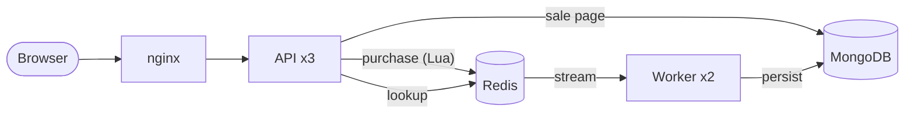
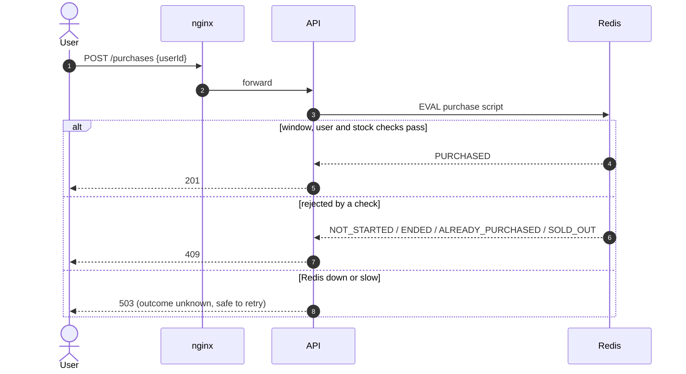
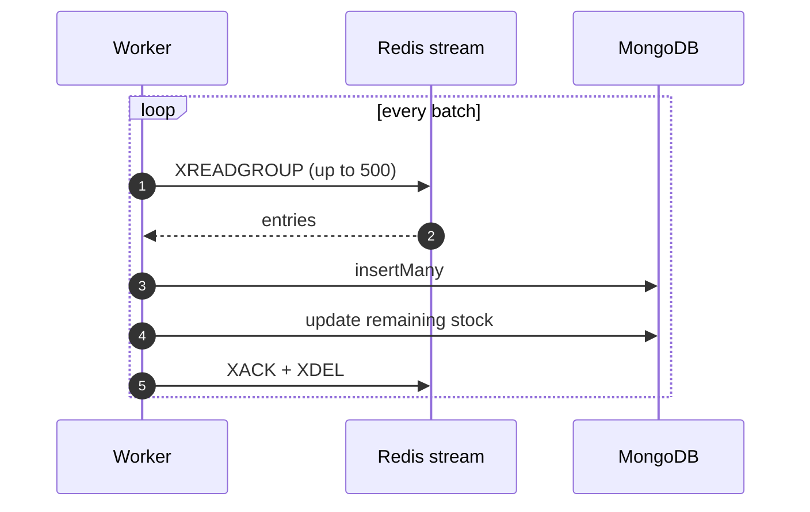
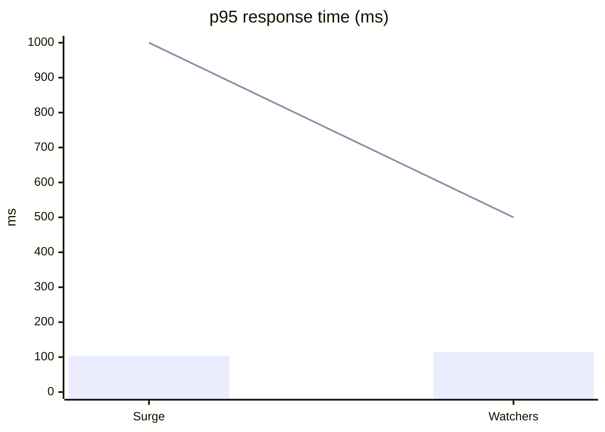

# Flash sale

A flash sale system for one product with limited stock.

## Tech stack

- API: Node.js (TypeScript) with Fastify
- Web: React, Vite, served by nginx
- Data: Redis and MongoDB
- Tests: Vitest, testcontainers, k6

## 1. Requirements

- One product, limited stock, a sale window with a start and an end, one item per user.
- Endpoints: sale status (upcoming, active, ended), attempt a purchase, check whether a user got an item.
- A simple frontend. The page also shows `sold_out` (active, nothing left).
- Non-functional: high throughput and scalability, fault tolerance, no overselling under concurrency.
- Stress tests with instructions, expected outcome and an explanation of the results.

For the purposes of this exercise, authentication is ignored.

## 2. Architecture

### High-level design



**Write path (purchase the product):**

1. The browser sends `POST /api/sales/:saleId/purchases` to **nginx**, which rate-limits and picks an **API** replica.
2. The **API** validates the request and runs one Lua script on **Redis**.
3. The script checks the window, one-per-user and stock, then decrements stock, sets the user key and appends to the purchase stream, all atomically. The API answers 201 or 409.
4. A **Worker** reads the stream in batches and writes the purchases to **MongoDB**, then updates the remaining stock.

**Read path:**

1. Sale page: the **API** reads the sale from **MongoDB**, so stock can lag slightly.
2. Purchase lookup: the **API** reads the user key from **Redis**, so it is correct as soon as the purchase commits.

### Flows

#### Purchase the product



#### Sync purchases to MongoDB



Malformed entries go to a dead-letter stream, and a failed batch is not acked, so it is retried.

A purchase is decided entirely in Redis; workers copy it to Mongo afterwards. The sale page reads Mongo, so its stock trails the real count.

### API

| Method | Path                                   | Purpose                        |
| ------ | -------------------------------------- | ------------------------------ |
| GET    | `/api/sales/:saleId`                   | Sale status and stock          |
| POST   | `/api/sales/:saleId/purchases`         | Try to purchase the product    |
| GET    | `/api/sales/:saleId/purchases/:userId` | Did this user make a purchase? |
| GET    | `/api/health`                          | Redis and Mongo check          |

#### `GET /api/sales/:saleId`

200:

```json
{
  "saleId": "8f3c1d2e-5a4b-4c6d-9e7f-1a2b3c4d5e6f",
  "status": "active",
  "startsAt": 1762650000000,
  "endsAt": 1762653600000,
  "stock": { "initial": 100, "remaining": 42 },
  "product": { "id": "...", "name": "Best Headphones" },
  "serverTime": 1762650123456
}
```

`status` is `upcoming`, `active`, `sold_out` or `ended`. Times are epoch milliseconds. Errors: 404 `sale_not_found`, 400 `invalid_request`, 503.

#### `POST /api/sales/:saleId/purchases`

Body: `{"userId": "alice"}`. The answer is always `{"code": "..."}`.

| HTTP | `code`                  | Meaning                                                                                    |
| ---- | ----------------------- | ------------------------------------------------------------------------------------------ |
| 201  | `PURCHASED`             | You got the item                                                                           |
| 409  | `ALREADY_PURCHASED`     | This user already has one                                                                  |
| 409  | `SOLD_OUT`              | No stock left                                                                              |
| 409  | `NOT_STARTED` / `ENDED` | Outside the sale window                                                                    |
| 503  | `NOT_CONFIGURED`        | The sale is not set up in Redis                                                            |
| 400  | n/a                     | `invalid_request` (bad body)                                                               |
| 503  | n/a                     | `temporarily_unavailable` (Redis down or slow). Outcome unknown, safe to retry (see below) |

**After a 503 the outcome is unknown.** The API stops waiting after 1 s, but Redis may still run the script afterwards. Retrying is safe: one item per user makes the purchase idempotent, so a retry returns `PURCHASED` or `ALREADY_PURCHASED`, never a second item. The web app checks the purchase before it reports a failure.

#### `GET /api/sales/:saleId/purchases/:userId`

- 200 `{"purchasedAt": 1762650100000}` (epoch ms)
- 404 `{"error": "purchase_not_found"}`
- 400 `invalid_request`, 503 if Redis is down

#### `GET /api/health`

- 200 `{"status": "ok"}`
- 503 `{"status": "unavailable"}` if Redis or Mongo does not answer within 1 s

#### Errors

- 503 comes with `Retry-After: 1` and `{"error": "temporarily_unavailable"}`.
- 429 `{"error": "too_many_requests"}` with `Retry-After: 1` comes from nginx when one address sends more than 100 requests a second.
- Any other unexpected error is a 500.

```bash
curl -X POST localhost:8080/api/sales/8f3c1d2e-5a4b-4c6d-9e7f-1a2b3c4d5e6f/purchases \
  -H 'content-type: application/json' -d '{"userId":"alice"}'
```

How a purchase works:

1. One Lua script on Redis checks, atomically, that the sale is configured, the time is inside the window, the user has no key, and stock is above zero.
2. If so, the same script decrements stock, sets the user key, and appends to the sale's stream. The API answers 201.
3. Workers read the stream via a consumer group in batches of up to 500, `insertMany` into Mongo (unordered), set `stock.remaining` from the stored count, then ack and delete the entries.

Redis keys for a sale share the hash tag `{sale:<id>}`.

## 3. Running the app

### Prerequisites

- Docker (with Compose v2). Docker must be running for `npm run check` too: the integration tests start their own Mongo and Redis containers.
- Node.js 26.13 (see `.nvmrc`), only for running the tests outside Docker.

### Start

```bash
docker compose up --build
```

Open `http://localhost:8080`. Stop with `docker compose down` (add `-v` to delete the Mongo and Redis volumes).

### Configure the sale

The `seed` service sets up the sale from these variables, read from your shell or a `.env` file in the repo root:

| Variable                 | Default | Meaning                                                        |
| ------------------------ | ------- | -------------------------------------------------------------- |
| `SALE_STARTS_AT`         | unset   | Start time, ISO 8601 (e.g. `2026-11-09T10:00:00+08:00`)        |
| `SALE_ENDS_AT`           | unset   | End time, ISO 8601                                             |
| `SALE_STARTS_IN_SECONDS` | `15`    | Start this many seconds from now, if `SALE_STARTS_AT` is unset |
| `SALE_DURATION_SECONDS`  | `3600`  | Length of the sale, if `SALE_ENDS_AT` is unset                 |
| `SALE_STOCK`             | `100`   | Number of items                                                |

```bash
SALE_STOCK=10 SALE_STARTS_IN_SECONDS=30 SALE_DURATION_SECONDS=300 npm run start
```

The seed is idempotent. On `docker compose up` it **keeps** a sale that is still running, with its purchases, so a restart loses nothing. It creates a fresh sale when the sale is missing from Mongo or Redis, or has ended. `npm run start` always creates a fresh sale (and deletes its purchases); new `SALE_*` values take effect on a reset.

## 4. Running the tests

### Unit and integration tests

```bash
npm ci
npm run check
```

The integration tests run the real API, two workers, Mongo and Redis. Besides the purchase flows, `invariants.test.ts` simulates a burst of requests through the API, waits for the workers to sync, and checks the real state of both stores: exactly the expected number sold, never more than the stock, no user twice, Mongo and Redis stock agree and are not negative, every buyer key has a Mongo purchase, the stream is drained and nothing was dead-lettered.

### Stress tests (k6)

```bash
npm run stress
```

Runs four scenarios together. k6 reads the stock from `SALE_STOCK`:

1. Hammer: one user fires 500 requests at once. Expected: 1 `PURCHASED`, 499 `ALREADY_PURCHASED`.
2. Surge: 10,000 users, up to 500 at a time, go for the rest of the stock. Expected with the default stock of 100: 99 `PURCHASED`, 9,901 `SOLD_OUT`.
3. Watchers: 300 people refresh the sale page every second for 15 seconds.
4. Flood: one address sends 1,000 requests without the `X-Load-Test: stress-test` header that the other scenarios send to skip the limit (demo only). Expected: at least one 429.

nginx rate-limits each client address to 100 requests per second.

#### Results

16,015 requests at about 537 per second, with up to 800 virtual users at once and no failed requests.

| Scenario | Outcome              | Count | Expected | Result |
| -------- | -------------------- | ----: | -------: | :----: |
| Hammer   | `PURCHASED`          |     1 |        1 |   ✅   |
| Hammer   | `ALREADY_PURCHASED`  |   499 |      499 |   ✅   |
| Surge    | `PURCHASED`          |    99 |       99 |   ✅   |
| Surge    | `SOLD_OUT`           | 9,901 |    9,901 |   ✅   |
| Flood    | 429 rate limited     |   791 |      > 0 |   ✅   |
| All      | Unexpected responses |     0 |        0 |   ✅   |

Response time at the 95th percentile (p95) against its threshold, in milliseconds:



The bars are the measured p95 (surge 104 ms, watchers 114 ms). The line is the threshold (1,000 ms and 500 ms). Overall: median 23 ms, p95 104 ms, p99 143 ms, max 204 ms.

## 5. Decisions and trade-offs

| Decision                                          | Why                                                                                                                                                                                                                                                                                                                                                                                                                                                       | Cost                                                                                                                               |
| ------------------------------------------------- | --------------------------------------------------------------------------------------------------------------------------------------------------------------------------------------------------------------------------------------------------------------------------------------------------------------------------------------------------------------------------------------------------------------------------------------------------------- | ---------------------------------------------------------------------------------------------------------------------------------- |
| Redis Lua script as the purchase gate             | **Atomicity and consistency:** the window, one-per-user and stock checks run as one isolated step on Redis's single thread, so there is no race and no oversell. **Throughput and low latency:** one round trip, in-memory, no locks, and no row contention like a hot Mongo document. **Availability:** the hot path needs only Redis, so purchases survive a Mongo outage. **Horizontal scalability:** the API tier is stateless, so replicas scale out | Redis is the source of truth while a sale runs and a single-core bottleneck for one hot sale. The page lags (eventual consistency) |
| Redis Streams instead of Kafka or a message queue | **No dual write:** the `XADD` is in the same Lua script as the stock decrement, so a purchase has a stream entry or nothing. A broker outside Redis needs a second network call, and a crash between the two loses or duplicates a purchase (outbox pattern needed). **Simplicity:** no new infrastructure. **Consumer groups** give competing consumers, backpressure through batching, and at-least-once delivery with idempotent writes (unique index) | Less durable and less scalable than Kafka: no partitioned log, long retention or easy replay. Fine for one sale, not for a fleet   |
| Dead-letter stream                                | **Fault isolation (poison-pill handling):** a malformed entry is moved aside instead of blocking the batch, so one bad message cannot stall the pipeline. **Recovery:** entries from a crashed worker are reclaimed after 30 s idle (self-healing), and the stream is kept for inspection                                                                                                                                                                 | Nothing replays or alerts on the dead-letter stream yet                                                                            |
| Redis AOF with `appendfsync everysec`             | **Durability and throughput trade-off:** a batched fsync keeps writes fast while limiting loss to about 1 s, instead of `always` (an fsync per write, slow) or `no` (OS decides, unbounded loss)                                                                                                                                                                                                                                                          | A crash can lose about 1 s of acknowledged purchases. Not built: `always`, a replica with `WAIT`, a reconcile script               |
| Delete acked stream entries                       | **Bounded memory and capacity:** Redis stays small so the hot path stays fast. **Single source of truth:** Mongo is the permanent record, and Redis is a transient buffer                                                                                                                                                                                                                                                                                 | No audit trail or replay from Redis                                                                                                |
| No deadline on the purchase script                | **Simplicity and one clock:** the script uses only Redis `TIME`. An earlier version also compared it with a deadline from the API host's clock, which ties correctness to clock sync between hosts                                                                                                                                                                                                                                                        | A timed-out request has an unknown outcome. Covered by idempotent retries (one per user) and the web app's follow-up check         |
| Idempotent seed                                   | **Durability:** restarting the stack keeps a running sale and its purchases. **Usability:** an ended or missing sale is recreated, so there is always a sale to try                                                                                                                                                                                                                                                                                       | Changing `SALE_*` needs an explicit `npm run start`                                                                                |

## 6. Improvements

Known gaps, and what I would do about each. None of these is built.

| Gap                                  | Improvement                                                                                                                                                                                                                                                                                                                      |
| ------------------------------------ | -------------------------------------------------------------------------------------------------------------------------------------------------------------------------------------------------------------------------------------------------------------------------------------------------------------------------------- |
| Identity                             | Real identity (login) and per-user limits                                                                                                                                                                                                                                                                                        |
| Idempotency                          | `Idempotency-Key` header if the rule ever allows several items per user                                                                                                                                                                                                                                                          |
| Each worker syncs one static sale ID | Workers discover active sales from Mongo                                                                                                                                                                                                                                                                                         |
| Dead-letter stream handling          | Alerting and reconciliation strategy                                                                                                                                                                                                                                                                                             |
| Single Redis and MongoDB nodes       | Run on Redis Cluster and a Mongo replica set:<br>• **Redis Cluster:** removes the single Redis node as a point of failure and spreads many concurrent sales across nodes. One sale still runs on one shard.<br>• **Mongo replica set:** purchases stay safe if the primary is lost, and the sale page can read from secondaries. |
| No end-to-end tests of the UI        | Browser tests (for example Playwright)                                                                                                                                                                                                                                                                                           |
